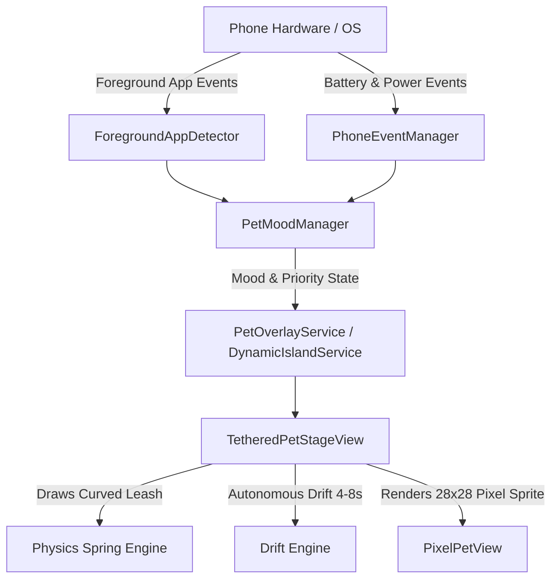

# AGENTS.md — Pixel Pet Architecture & Guide for Autonomous Agents

This document provides technical context, architecture specifications, and engineering guidelines for AI coding assistants and developers maintaining or extending **Pixel Pet**.

---

## 🐣 Project Overview

**Pixel Pet** is an Android application that renders a borderless, transparent, animated pixel-art companion tethered to the phone's front camera cutout. The character acts as a living digital pet with physical leash mechanics, autonomous drift, contextual emotional reactions based on foreground app usage (e.g. Instagram, Google Apps, reading/learning apps), phone events (charging, low battery, unlock), and local nighttime sleepiness.

---

## 🏛️ Core Architecture



### Component Breakdown

1. **`com.dynamicisland.app.view.PixelPetView`**:
   - High-performance, anti-aliasing-free Canvas pixel-art renderer ($28 \times 28$ integer grid).
   - Manages character expressions:
     - `IDLE`: Buoyant float, breathing squash/stretch, eye blinks, looking around, sprout sway.
     - `HAPPY`: Joyful hops, crinkled closed eyes (`^ _ ^`), star sparkles.
     - `SAD`: Pale blue body (`#90CAF9`), droopy posture, animated trickling teardrops, tiny frown.
     - `ANGRY`: Crimson body (`#EF5350`), rage vibration shake, rising steam puffs.
     - `NERD`: Falling animated nerd glasses with bounce, left-to-right scanning reading eyes.
     - `SLEEPY`: Muted lavender body (`#B39DDB`), droopy eye slits, yawns, floating "Zzz" particles.
     - `CHARGING`: Soft mint green (`#A7F3D0`), gentle energy sparkles, peaceful expression.
     - `LOW_BATTERY`: Amber body (`#FB923C`), wide worried eyes glancing at battery indicator.
     - `CRITICAL_BATTERY`: Pale red body (`#F87171`), dramatic fainting collapse ($55^\circ$ tilt) with `X X` eyes.

2. **`com.dynamicisland.app.view.TetheredPetStageView`**:
   - Transparent overlay container positioned over the front camera reference coordinate.
   - Draws a golden anchor ring over the camera lens.
   - Calculates a dynamic, sagging catenary curve (`Path.quadTo`) connecting the camera anchor to the pet's head sprout.
   - Hosts the autonomous drift engine: every $4.5\text{s} - 8.5\text{s}$, the pet floats to a new organic spot (left, right, underneath pendant, leaning, close hover). Never sits still $> 10\text{s}$.
   - Non-draggable overlay: touch reactions can be toggled in settings; when disabled, the window applies `FLAG_NOT_TOUCHABLE` for $100\%$ click-through.

3. **`com.dynamicisland.app.util.PetMoodManager`**:
   - Resolves pet emotional state according to a strict priority hierarchy:
     1. `CRITICAL_BATTERY` ($<5\%$)
     2. `CHARGING` (Power connected)
     3. `LOW_BATTERY` ($<15\%$)
     4. `ANGRY` (Instagram open continuously $\ge 5\text{ min}$)
     5. `SAD` (Instagram in foreground)
     6. `NERD` (Learning apps: ChatGPT, Gemini, WPS, ONLYOFFICE, PDF readers, Google apps)
     7. `SLEEPY` (Local time curve $\ge 22:00$ / $10\text{ PM}$)
     8. `HAPPY` (Pet app open or tap interaction)
     9. `IDLE` (Default)
   - Tracks continuous session time for Instagram and resets to zero the instant the user exits.

4. **`com.dynamicisland.app.util.ForegroundAppDetector`**:
   - Polls `UsageStatsManager.queryEvents()` (`ACTIVITY_RESUMED` / `MOVE_TO_FOREGROUND`) every $500\text{ms}$.
   - Resolves package names to human-readable app titles.
   - Buffers a live history log for the in-app debug terminal.

5. **`com.dynamicisland.app.util.PhoneEventManager`**:
   - Lifecycle-managed `BroadcastReceiver` listening to `ACTION_USER_PRESENT`, `ACTION_POWER_CONNECTED`, `ACTION_POWER_DISCONNECTED`, and `ACTION_BATTERY_CHANGED`.

6. **`com.dynamicisland.app.DynamicIslandService`**:
   - Foreground service with `TYPE_APPLICATION_OVERLAY` and `PixelFormat.TRANSLUCENT`.
   - Manages window attachment, camera offset coordinates, and touch pass-through.

---

## 🔒 Security & Google Play Protect Policies

- **NEVER declare `BIND_ACCESSIBILITY_SERVICE`**: Sideloaded APKs with accessibility services are automatically blocked by Google Play Protect as Potentially Harmful Applications (PHA).
- **Usage Stats**: Uses `android.permission.PACKAGE_USAGE_STATS`. On Android 13/14+, users must unlock sideloaded restricted settings once (Settings $\to$ Apps $\to$ Pixel Pet $\to$ 3 dots $\to$ "Allow restricted settings").
- **Overlay Security**: Uses standard `android.permission.SYSTEM_ALERT_WINDOW`.

---

## 🛠️ Build & Verification Instructions

### Requirements
- JDK 17
- Android SDK 34 (Build tools 34.0.0)

### Commands
```bash
# Run unit tests
./gradlew test

# Compile debug APK
./gradlew assembleDebug

# Install to connected device via ADB
adb install -r app/build/outputs/apk/debug/app-debug.apk

# Fast-grant permissions via ADB (optional for developers)
adb shell appops set com.dynamicisland.app SYSTEM_ALERT_WINDOW allow
adb shell appops set com.dynamicisland.app ACCESS_RESTRICTED_SETTINGS allow
adb shell appops set com.dynamicisland.app GET_USAGE_STATS allow
```
