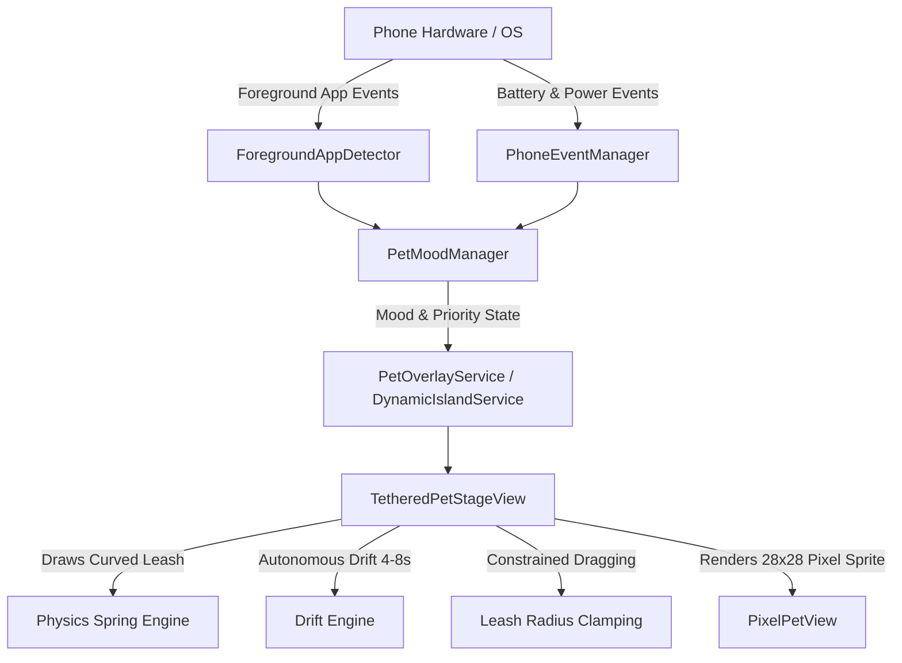

# AGENTS.md — Pixel Pet Architecture & Guide for Autonomous Agents

This document provides comprehensive technical context, architecture specifications, and engineering guidelines for AI coding assistants and developers maintaining or extending **Pixel Pet**.

---

## 🐣 Project Overview

**Pixel Pet** is an Android application that renders a borderless, transparent, animated pixel-art companion tethered to the phone's front camera cutout. The character acts as a living digital pet with physical leash mechanics, autonomous drift, contextual emotional reactions based on foreground app usage (e.g. Instagram, Google Apps, reading/learning apps), phone events (charging, low battery, unlock), and local nighttime sleepiness.

---

## 🏛️ Core Architecture



### Component Breakdown

1. **`com.dynamicisland.app.view.PixelPetView`**:
   - High-performance, anti-aliasing-free Canvas pixel-art renderer ($28 \times 28$ integer grid).
   - Manages character expressions:
     - `IDLE`: Buoyant float, breathing squash/stretch, eye blinks, looking around, sprout sway.
     - `HAPPY`: Joyful hops, crinkled closed eyes (`^ _ ^`), star sparkles.
     - `SAD`: Pale blue body (`#90CAF9`), droopy posture, animated trickling teardrops, tiny frown.
     - `ANGRY`: Crimson body (`#EF5350`), rage vibration shake, rising steam puffs.
     - `NERD`: Falling animated nerd glasses with bounce, left-to-right scanning reading eyes.
     - `SLEEPY`: Muted lavender body (`#B39DDB`), droopy eye slits, yawns, floating "Zzz" particles.
     - `CHARGING`: Soft mint green (`#A7F3D0`), gentle energy sparkles, peaceful expression.
     - `LOW_BATTERY`: Amber body (`#FB923C`), wide worried eyes glancing at battery indicator.
     - `CRITICAL_BATTERY`: Pale red body (`#F87171`), dramatic fainting collapse ($55^\circ$ tilt) with `X X` eyes.
     - `TEXTING`: Cheerful teal body (`#2DD4BF`), animated speech bubble (`💬`) with cycling typing dots (`• • •`), rapid typing hands tapping in front of body.
2. **`com.dynamicisland.app.view.TetheredPetStageView`**:
   - Transparent overlay container positioned over the front camera reference coordinate $(cameraRefX, cameraRefY)$.
   - Draws a golden anchor ring over the camera lens.
   - Calculates a dynamic, sagging catenary curve (`Path.quadTo`) connecting the camera anchor to the pet's head sprout.
   - **Autonomous Drift Engine**: Every $4.5\text{s} - 8.5\text{s}$, the pet floats to a new organic spot (left, right, underneath pendant, leaning, close hover). Never sits still $> 10\text{s}$.
   - **Leash-Constrained Dragging**: Touch and drag allows user to move the pet, strictly clamped to the leash radius ($1.15 \times \text{leashLengthDp}$).
   - **Elastic Snap-Back**: Upon drag release, pet springs back with `OvershootInterpolator(2.2f)` damped oscillation.
   - **Tap Interactions**:
     - *Sleep/Wake Toggle*: Tapping sleepy pet wakes it up; tapping again nods it off to sleep.
     - *Rapid Multi-Tap Temper Tantrum*: $3+$ taps within $650\text{ms}$ triggers a $3.8\text{s}$ furious angry tantrum with steam puffs, followed by an embarrassed blush.
     - *Single Tap*: Contextual reactions (happy wink, wave, giggle, or glasses adjust).
   - **Shape-Matched Touch Detection (`TouchableRegionHelper.kt`)**:
     - Registers an `OnComputeInternalInsetsListener` via dynamic proxy with `TOUCHABLE_INSETS_REGION`.
     - Restricts the window's touchable region strictly to the pet's visible circular body shape.
     - **100% Touch Pass-Through Outside Pet**: Punches a transparent touch hole across the entire remainder of the window so user taps on camera, status bar, and underlying apps pass through completely uninterrupted.

3. **`com.dynamicisland.app.util.TouchableRegionHelper`**:
   - Dynamically hooks Android's internal `ViewTreeObserver.OnComputeInternalInsetsListener`.
   - Supplies an `android.graphics.Region` generated from `Path.addCircle(petCenterX, petCenterY, radius)` matching the pet's exact coordinates.
   - Synchronizes touchable region in real-time as the pet drifts or is dragged.

4. **`com.dynamicisland.app.util.PetMoodManager`**:
   - Resolves pet emotional state according to a strict priority hierarchy:
     1. `CRITICAL_BATTERY` ($<5\%$)
     2. `CHARGING` (Power connected)
     3. `LOW_BATTERY` ($<15\%$)
     4. `ANGRY` (Instagram open continuously $\ge 5\text{ min}$)
     5. `SAD` (Instagram in foreground)
     6. `TEXTING` (Messaging apps: WhatsApp, Discord, Messages, LinkedIn, Telegram, Signal, Slack)
     7. `NERD` (Learning apps: ChatGPT, Gemini, WPS, ONLYOFFICE, PDF readers, Google apps)
     8. `SLEEPY` (Local time curve $\ge 22:00$ / $10\text{ PM}$)
     9. `HAPPY` (Pet app open or tap interaction)
     10. `IDLE` (Default)
   - Tracks continuous session time for Instagram and resets to zero the instant the user exits.

4. **`com.dynamicisland.app.util.ForegroundAppDetector`**:
   - Polls `UsageStatsManager.queryEvents()` (`ACTIVITY_RESUMED` / `MOVE_TO_FOREGROUND`) every $500\text{ms}$.
   - Resolves package names to human-readable app titles.
   - Buffers a live history log for the in-app debug terminal (`DebugActivity.kt`).

5. **`com.dynamicisland.app.util.PhoneEventManager`**:
   - Lifecycle-managed `BroadcastReceiver` listening to `ACTION_USER_PRESENT`, `ACTION_POWER_CONNECTED`, `ACTION_POWER_DISCONNECTED`, and `ACTION_BATTERY_CHANGED`.

6. **`com.dynamicisland.app.DynamicIslandService`**:
   - Persistent Foreground Service running with `TYPE_APPLICATION_OVERLAY` and `specialUse` foreground service type.
   - Configured with `android:stopWithTask="false"` and `onTaskRemoved` auto-restart alarm so the overlay never dies when swiped from recent apps.
   - Hosts `TetheredPetStageView` anchored over the camera cutout $(cameraRefX, cameraRefY)$.

---

## 📦 Releases & Versioning Architecture

### Version Tracking
  versionCode = 2
  versionName = "1.0.1"
  ```
- Public version tag in `README.md`:
  `**Current Version:** v1.0.1`
- Prebuilt APK is whitelisted in `.gitignore` and committed directly to the repo at:
  `app/build/outputs/apk/debug/app-debug.apk`

### GitHub Actions Release Workflow (`.github/workflows/release.yml`)
- **Triggers**:
  - Push to `main` exclusively (pushes to other branches like `optimization` do not run releases)
  - Manual execution via `workflow_dispatch`
- **Workflow Pipeline**:
  1. Checks out repository.
  2. Sets up JDK 17 (Temurin).
  3. Extracts version from `app/build.gradle.kts` (or tag name).
  4. Verifies/builds `app/build/outputs/apk/debug/app-debug.apk`.
  5. Packages and copies `PixelPet-${VERSION}.apk`.
  6. Publishes a GitHub Release with assets using `softprops/action-gh-release@v2`.

### Steps for Agents Bumping Versions
1. Update `versionCode` and `versionName` in `app/build.gradle.kts`.
2. Update the version badges and text in `README.md`.
3. Recompile the debug APK: `./gradlew assembleDebug`.
4. Run tests: `./gradlew test`.
5. Commit `.gitignore`, `README.md`, `app/build.gradle.kts`, and `app/build/outputs/apk/debug/app-debug.apk`.
6. Merge or push to `main` (which automatically triggers the release workflow).

---

## 🔒 Security & Google Play Protect Policies

- **NEVER declare `BIND_ACCESSIBILITY_SERVICE`**: Sideloaded APKs with accessibility services are automatically blocked by Google Play Protect as Potentially Harmful Applications (PHA).
- **Usage Stats**: Uses `android.permission.PACKAGE_USAGE_STATS`. On Android 13/14+, users must unlock sideloaded restricted settings once (Settings $\to$ Apps $\to$ Pixel Pet $\to$ 3 dots $\to$ "Allow restricted settings").
- **Overlay Security**: Uses standard `android.permission.SYSTEM_ALERT_WINDOW`.

---

## 🛠️ Build & Verification Instructions

### Requirements
- JDK 17
- Android SDK 34 (Build tools 34.0.0)

### Commands
```bash
# Run unit tests
./gradlew test

# Compile debug APK
./gradlew assembleDebug

# Install to connected device via ADB
adb install -r app/build/outputs/apk/debug/app-debug.apk

# Fast-grant permissions via ADB (optional for developers)
adb shell appops set com.dynamicisland.app SYSTEM_ALERT_WINDOW allow
adb shell appops set com.dynamicisland.app ACCESS_RESTRICTED_SETTINGS allow
adb shell appops set com.dynamicisland.app GET_USAGE_STATS allow
```
